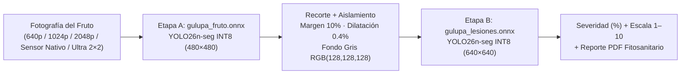

<div align="center">

# 🟣 GulupaScan v0.3.0
### Detección y Cuantificación de Severidad de Daños Epidérmicos en Gulupa (*Passiflora edulis* Sims) mediante Modelos ONNX `YOLO26n-seg` en Dos Etapas (Android & iOS)

[](https://github.com/jf-floresriera/gulupascaner/releases)
[](https://github.com/jf-floresriera/gulupascaner/actions)
[](./iosApp)
[](./models/README.md)
[](./scripts/referencia_onnx.py)
[](./CITATION.cff)

**Universidad Nacional de Colombia (UNAL)** · *Facultad de Ciencias Agrarias & Facultad de Ingeniería*

[Manual Técnico y de Usuario](./docs/MANUAL_USUARIO_Y_TECNICO.md) · [Explorar Modelos ONNX](./models/README.md) · [Descargar APK (Actions)](https://github.com/jf-floresriera/gulupascaner/actions) · [Guía de Reproducción](#5-instalación-y-ejecución-paso-a-paso) · [Cómo Citar](#8-cómo-citar-esta-investigación--how-to-cite)

</div>

---

## 📑 Índice de Contenidos

1. [Descripción General del Proyecto](#1-descripción-general-del-proyecto)
2. [Arquitectura de Inteligencia Artificial en Dos Etapas (`YOLO26n-seg`)](#2-arquitectura-de-inteligencia-artificial-en-dos-etapas-yolo26n-seg)
3. [Modos de Resolución de Cámara e Inferencia Multi-Escala `2×2`](#3-modos-de-resolución-de-cámara-e-inferencia-multi-escala-22)
4. [Stack Tecnológico por Sistema Operativo](#4-stack-tecnológico-por-sistema-operativo)
5. [Instalación y Ejecución Paso a Paso (Android, iOS, Anaconda y Docker)](#5-instalación-y-ejecución-paso-a-paso)
6. [Estructura del Repositorio](#6-estructura-del-repositorio)
7. [Equipo de Investigación y Desarrollo](#7-equipo-de-investigación-y-desarrollo)
8. [Cómo Citar esta Investigación / How to Cite](#8-cómo-citar-esta-investigación--how-to-cite)

---

## 1. Descripción General del Proyecto

**GulupaScan** es una herramienta científica y agronómica de **diagnóstico fitosanitario asistido por visión computacional en el borde (*Edge AI*)** para frutos de gulupa (*Passiflora edulis* f. *edulis* Sims). Funciona **100 % sin conexión a internet** directamente en teléfonos **Android** e **iPhone (iOS)**, permitiendo a productores, asistentes técnicos y empacadoras de exportación cuantificar en segundos:

- **Sarna o Roña** (*Cladosporium cladosporioides*)
- **Antracnosis** (*Colletotrichum gloeosporioides*)
- **Mancha de Aceite / Bacteriosis** (*Xanthomonas axonopodis* pv. *passiflorae*)
- **Porcentaje exacto de área epidérmica afectada (%)**, clasificación en **escala de severidad 1–10** y generación de **informes técnicos en PDF**.

---

## 2. Arquitectura de Inteligencia Artificial en Dos Etapas (`YOLO26n-seg`)



| Etapa | Archivo ONNX (INT8) | Entrada | Salidas (`output0` / `output1`) | Peso FP32 | Peso INT8 | IoU vs. PyTorch | Detección Principal | Documentación |
| :--- | :--- | :--- | :--- | :---: | :---: | :---: | :---: | :--- |
| **Etapa A (Fruto)** | `gulupa_fruto.onnx` | `[1, 3, 480, 480]` | `[1, 300, 38]` / `[1, 32, 120, 120]` | 11.07 MB | **3.23 MB** | **0.9813** | **100.0 %** | [`MODELO_A_FRUTO.md`](./models/MODELO_A_FRUTO.md) |
| **Etapa B (Lesiones)** | `gulupa_lesiones.onnx` | `[1, 3, 640, 640]` | `[1, 300, 38]` / `[1, 32, 160, 160]` | 11.14 MB | **3.30 MB** | **0.9022** | **100.0 %** | [`MODELO_B_LESIONES.md`](./models/MODELO_B_LESIONES.md) |

La severidad total se calcula píxel a píxel sobre la rejilla del recorte:

$$\text{Severidad Total (\%)} = 100 \times \frac{\text{Área}(\text{Lesiones} \cap \text{Fruto})}{\text{Área}(\text{Fruto} \cup \text{Lesiones})}$$

---

## 3. Modos de Resolución de Cámara e Inferencia Multi-Escala `2×2`

Tanto en la barra inferior de la cámara como en la pantalla de **Configuración**, el usuario puede elegir entre **5 niveles de resolución** según la capacidad del teléfono y el tamaño de las lesiones:

| Nivel | Resolución de Entrada | Descripción Técnica |
| :--- | :---: | :--- |
| **Baja (`LOW`)** | `640 px` (VGA) | Captura rápida de baja latencia para teléfonos básicos. |
| **Media (`MEDIUM`)** | `1024 px` (HD) | Balance ágil de 1 pasada para monitoreo rápido en lote. |
| **Alta (`HIGH`)** | `2048 px` (2K) | Estándar recomendado: garantiza que el recorte del fruto conserve $\ge 640\text{ px}$ reales. |
| **Original (`ORIGINAL`)** | **100 % Sensor Nativo** | Conserva la resolución nativa completa del sensor de la cámara (12 MP – 48 MP) sin reescalado previo. |
| **Ultra `2×2` (`ULTRA`)** | **Nativa / 4K + Tiling `2×2`** | Ejecuta 1 pasada global + 4 cuadrantes superpuestos al 60 % con `gulupa_lesiones.onnx`, alcanzando **`1280×1280` píxeles efectivos** sobre el fruto sin necesidad de reentrenar los pesos ONNX. |

---

## 4. Stack Tecnológico por Sistema Operativo

| Componente | Android (`app/` y `app/android/`) | iOS (`iosApp/`) | Backend / Validación (`app/backend/`, `scripts/`) |
| :--- | :--- | :--- | :--- |
| **Lenguaje** | Kotlin `2.0.21` (JVM 17) | Swift `5.9+` | Python `3.10+` |
| **Framework UI** | Jetpack Compose + Material 3 | SwiftUI + Canvas nativo | Flask + Gunicorn REST API |
| **Motor de Inferencia** | `onnxruntime-android:1.20.0` | `onnxruntime-objc:1.24.2` | `onnxruntime` / `ultralytics` |
| **Cámara y Galería** | CameraX `1.4.1` (`ResolutionSelector` 4:3) | `PhotosPicker` + `UIImagePickerController` | OpenCV (`cv2`) + NumPy |
| **Reportes** | Android `PdfDocument` | `UIGraphicsPDFRenderer` | JSON + Capas PNG/JPEG Base64 |

---

## 5. Instalación y Ejecución Paso a Paso

### A. Validador de Referencia y Entorno Python con **Anaconda / Conda**

```bash
# 1. Clonar el repositorio
git clone https://github.com/jf-floresriera/gulupascaner.git
cd gulupascaner

# 2. Crear y activar entorno Conda
conda create -n gulupascan python=3.11 -y
conda activate gulupascan

# 3. Instalar dependencias de inferencia ONNX y visión por computador
pip install onnxruntime opencv-python numpy flask PyGithub

# 4. Ejecutar validación de referencia sobre una fotografía en cualquier resolución
python scripts/referencia_onnx.py --resolucion high ruta/a/foto_gulupa.jpg
```

### B. Despliegue del Backend API con **Docker**

```bash
# Construir imagen del servidor de inferencia a partir del proyecto base
docker build -t gulupascan-api -f proyecto-base/powderyvision7/Dockerfile .

# Ejecutar contenedor en el puerto 5000
docker run --rm -p 5000:5000 -e PORT=5000 gulupascan-api
```

### C. Compilación de la App **Android** (Android Studio / Gradle)

```bash
# Compilar APK Debug desde la raíz del proyecto
./gradlew :app:assembleDebug

# El APK instalable se genera en:
# app/build/outputs/apk/debug/app-debug.apk
```

### D. Compilación de la App **iOS** (macOS con Xcode 15/16+)

```bash
# Compilar e instalar en el simulador iPhone 17
xcodebuild -project iosApp/GulupaScan.xcodeproj \
           -scheme GulupaScan \
           -destination 'platform=iOS Simulator,name=iPhone 17' \
           -derivedDataPath /tmp/GulupaScanBuild build

xcrun simctl install "iPhone 17" /tmp/GulupaScanBuild/Build/Products/Debug-iphonesimulator/GulupaScan.app
xcrun simctl launch "iPhone 17" co.edu.unal.gulupascan
```

---

## 6. Estructura del Repositorio

```text
gulupascaner/
├── app/                        # Proyecto Android principal (Kotlin + Jetpack Compose + ONNX)
│   ├── src/main/assets/        # Modelos gulupa_fruto.onnx, gulupa_lesiones.onnx y metadatos JSON
│   └── android/                # Espejo Android sincronizado para el workflow CI/CD de GitHub Actions
├── iosApp/                     # Proyecto nativo iOS (SwiftUI + ONNX Runtime ObjC)
│   ├── GulupaScan.xcodeproj/   # Proyecto Xcode listo para abrir y ejecutar
│   └── GulupaScan/             # Modelos, Servicios ONNX, Vistas SwiftUI y Recursos
├── models/                     # Fichas técnicas detalladas (MODELO_A_FRUTO.md y MODELO_B_LESIONES.md)
├── scripts/                    # Validador de referencia ONNX (referencia_onnx.py) y utilidades GitHub
├── docs/                       # Documentación técnica, guía de modelos y kit de divulgación científica
├── CITATION.cff                # Metadatos oficiales de citación científica para GitHub
└── README.md                   # Este documento
```

---

## 7. Equipo de Investigación y Desarrollo

- **Jesús Enrique Flores-Riera** — *Facultad de Ciencias Agrarias, Universidad Nacional de Colombia (UNAL)*
- **Joaquín Guillermo Ramírez-Gil** — *Profesor Asociado, Facultad de Ciencias Agrarias, Universidad Nacional de Colombia (UNAL)*
- **Luis Alberto Castillo Sanabria** — *Facultad de Ciencias Agrarias, Universidad Nacional de Colombia (UNAL)*
- **Diego Humberto Lavado González** — *Facultad de Ingeniería, Universidad Nacional de Colombia (UNAL)*
- **Daniel Felipe Ahumada Hernández** — *Facultad de Ingeniería, Universidad Nacional de Colombia (UNAL)*

---

## 8. Cómo Citar esta Investigación / How to Cite

Si utilizas **GulupaScan**, sus modelos ONNX cuantizados o su arquitectura móvil en tus trabajos académicos, tesis o desarrollos tecnológicos, por favor cita este repositorio:

### Formato BibTeX
```bibtex
@software{flores_riera_gulupascan_2026,
  author       = {Flores-Riera, Jes{\'u}s Enrique and
                  Ram{\'i}rez-Gil, Joaqu{\'i}n Guillermo and
                  Castillo Sanabria, Luis Alberto and
                  Lavado Gonz{\'a}lez, Diego Humberto and
                  Ahumada Hern{\'a}ndez, Daniel Felipe},
  title        = {{GulupaScan: Detection and Severity Quantification of Epidermal Damage in Purple Passion Fruit (Passiflora edulis Sims) Using Dual-Stage YOLO26n-seg ONNX Models}},
  year         = {2026},
  publisher    = {GitHub},
  version      = {0.3.0},
  institution  = {Universidad Nacional de Colombia},
  url          = {https://github.com/jf-floresriera/gulupascaner}
}
```

### Formato APA (7.ª Edición)
> Flores-Riera, J. E., Ramírez-Gil, J. G., Castillo Sanabria, L. A., Lavado González, D. H., & Ahumada Hernández, D. F. (2026). *GulupaScan: Detection and Severity Quantification of Epidermal Damage in Purple Passion Fruit (Passiflora edulis Sims) Using Dual-Stage YOLO26n-seg ONNX Models* (Versión 0.3.0) [Software de computador]. Universidad Nacional de Colombia. https://github.com/jf-floresriera/gulupascaner
