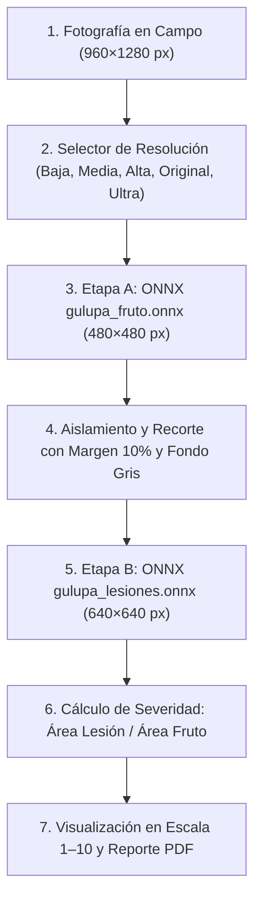

# 🌿 Manual Técnico y de Usuario — GulupaScan (Android & iOS)

> **Documento de Construcción Técnica y Operación de la Herramienta**  
> **Resultado de Tesis de Maestría — Autor y desarrollador principal: Luis Alberto Castillo Sanabria**  
> **Con el apoyo de la Universidad Nacional de Colombia y del Laboratorio de Agrocomputación y Análisis Epidemiológico, Facultad de Ciencias Agrarias**  
> **Versión de la Aplicación:** `0.3.0` (Android) / `2.0.0` (iOS)  
> **Pipeline de Inteligencia Artificial:** `YOLO26n-seg` en cascada (2 etapas ONNX)  

---

## 📑 Tabla de Contenidos

1. [Resumen Ejecutivo y Propósito](#1-resumen-ejecutivo-y-propósito)
2. [Autoría, Equipo y Apoyo Institucional](#2-autoría-equipo-y-apoyo-institucional)
3. [Flujo de Trabajo Paso a Paso con la Muestra Real](#3-flujo-de-trabajo-paso-a-paso-con-la-muestra-real)
4. [Pipeline de Inteligencia Artificial (ONNX en 2 Etapas)](#4-pipeline-de-inteligencia-artificial-onnx-en-2-etapas)
5. [Impacto de las 5 Resoluciones de Entrada](#5-impacto-de-las-5-resoluciones-de-entrada)
6. [Pantallazos y Funcionamiento Módulo por Módulo (Android & iOS)](#6-pantallazos-y-funcionamiento-módulo-por-módulo-android--ios)
   - [Módulo 1: Autenticación y Perfil del Productor](#módulo-1-autenticación-y-perfil-del-productor)
   - [Módulo 2: Cámara y Selector Dinámico de 5 Resoluciones](#módulo-2-cámara-y-selector-dinámico-de-5-resoluciones)
   - [Módulo 3: Procesamiento en el Teléfono (ONNX Offline)](#módulo-3-procesamiento-en-el-teléfono-onnx-offline)
   - [Módulo 4: Tipos de Daño Detectados](#módulo-4-tipos-de-daño-detectados)
   - [Módulo 5: Detalle del Daño y Escala Visual de Severidad 1–10](#módulo-5-detalle-del-daño-y-escala-visual-de-severidad-110)
   - [Módulo 6: Resultado Final, Exportación PDF y Compartir](#módulo-6-resultado-final-exportación-pdf-y-compartir)
   - [Módulo 7: Métricas Técnicas y Diagnóstico del Modelo](#módulo-7-métricas-técnicas-y-diagnóstico-del-modelo)
   - [Módulo 8: Historial Local de Diagnósticos](#módulo-8-historial-local-de-diagnósticos)
   - [Módulo 9: Alertas Fitosanitarias y Umbrales Críticos](#módulo-9-alertas-fitosanitarias-y-umbrales-críticos)
   - [Módulo 10: Perfil, Configuración y Personalización](#módulo-10-perfil-configuración-y-personalización)
   - [Módulo 11: Guía de Toma de Fotografías](#módulo-11-guía-de-toma-de-fotografías)
   - [Módulo 12: Información Técnica del Equipo y Créditos](#módulo-12-información-técnica-del-equipo-y-créditos)
7. [Arquitectura de Software y Código Fuente](#7-arquitectura-de-software-y-código-fuente)
8. [Instrucciones de Compilación y Ejecución](#8-instrucciones-de-compilación-y-ejecución)

---

## 1. Resumen Ejecutivo y Propósito

**GulupaScan** es una solución móvil multiplataforma (**Android** nativo en Jetpack Compose y **iOS** nativo en SwiftUI) concebida para la detección, diagnóstico y cuantificación porcentual de enfermedades que afectan al fruto de la **gulupa** (*Passiflora edulis* f. *edulis*), con foco prioritario en la **Sarna o Roña** (*Cladosporium oxysporum / Cladosporium cladosporioides*), la **Antracnosis** (*Colletotrichum gloeosporioides*) y la **Mancha de aceite** (*Xanthomonas axonopodis* pv. *passiflorae*).

A diferencia de las aplicaciones convencionales que dependen obligatoriamente de conexión a internet o servidores en la nube, **GulupaScan opera 100% en modo local (*On-Device Offline*)** mediante el motor optimizado **ONNX Runtime**, permitiendo al agricultor y al asistente técnico obtener diagnósticos precisos en menos de 2 segundos directamente en la parcela o finca rural, sin señal celular.

---

## 2. Autoría, Equipo y Apoyo Institucional

**GulupaScan** es un resultado de la **tesis de maestría de Luis Alberto Castillo Sanabria**, quien es el **autor principal y desarrollador principal de la herramienta**: diseño de la aplicación, implementación en Android e iOS, integración de los modelos ONNX y documentación técnica.

### Equipo
| Integrante | Rol en el proyecto |
|:---|:---|
| **Luis Alberto Castillo Sanabria** | Autor principal y desarrollador principal (tesis de maestría) |
| **Jesús Enrique Flores-Riera** | Coautor |
| **Joaquín Guillermo Ramírez-Gil** | Coautor — Profesor Asociado, Facultad de Ciencias Agrarias |
| **Diego Humberto Lavado González** | Coautor |
| **Daniel Felipe Ahumada Hernández** | Coautor |

Los integrantes del equipo son estudiantes de la **Universidad Nacional de Colombia (UNAL)**, con la participación del profesor asociado **Joaquín Guillermo Ramírez-Gil** de la Facultad de Ciencias Agrarias.

### Apoyo Institucional
El proyecto contó con el apoyo de la **Universidad Nacional de Colombia** y del **Laboratorio de Agrocomputación y Análisis Epidemiológico** de la **Facultad de Ciencias Agrarias**.

### Repositorio
Código fuente, modelos ONNX (gestionados con **Git LFS**) y esta documentación: <https://github.com/LCastillo9806/GulupaScan>

---

## 3. Flujo de Trabajo Paso a Paso con la Muestra Real

Para la validación de este manual se empleó la fotografía real tomada en campo:  
`WhatsApp Image 2026-11-02 at 6.45.15 PM.jpeg` (`960 × 1280` píxeles, cámara móvil).



---

## 4. Pipeline de Inteligencia Artificial (ONNX en 2 Etapas)

La aplicación ejecuta un pipeline en cascada compuesto por dos redes neuronales convolucionales de segmentación de instancias basadas en la arquitectura **YOLO26n-seg**:

### 1. Etapa A: Localización y Aislamiento del Fruto (`gulupa_fruto.onnx`)
- **Resolución de entrada de la red:** `480 × 480` píxeles con preprocesamiento *letterbox* (relleno con color neutro 114).
- **Función:** Detecta la coordenada espacial del fruto en el encuadre general y genera una máscara booleana que separa el fruto de hojas, ramas, manos del evaluador o suelo.
- **Resultado en la muestra real:** Detección de fruto con **80.56% de confianza**.

| 1. Fotografía original | 2. Detección y máscara Etapa A (480x480) | 3. Recorte centrado con fondo neutro |
|:---:|:---:|:---:|
|  |  |  |

### 2. Recorte Inteligente y Supresión de Fondo
- Se toma la caja delimitadora del fruto y se le añade un **margen de seguridad del 10%**.
- Los píxeles situados fuera del contorno del fruto se sustituyen por un gris neutro balanceado `RGB(128, 128, 128)`, eliminando posibles falsos positivos generados por el fondo agrícola.

### 3. Etapa B: Segmentación de Lesiones Fitosanitarias (`gulupa_lesiones.onnx`)
- **Resolución de entrada de la red:** `640 × 640` píxeles.
- **Función:** Analiza minuciosamente la superficie del fruto recortado, discriminando entre tejido vegetal sano y síntomas de **Sarna (*Scab*)**, **Antracnosis (*Anthracnose*)** o **Mancha de aceite (*Oil spot*)**.
- **Resultado en la muestra real:** Segmentación precisa de costras corchosas de Sarna con **área afectada del 32.59%** (en inferencia de referencia pura) y **36.3%** en visualización con interpolación móvil.

| 4. Máscara binaria Etapa B (640x640) | 5. Superposición RGBA de lesiones | 6. Diagnóstico final fusionado |
|:---:|:---:|:---:|
|  |  |  |

---

## 5. Impacto de las 5 Resoluciones de Entrada

### ¿Se debe reentrenar el modelo para soportar resoluciones altas?
> [!IMPORTANT]
> **No es necesario reentrenar los modelos**. Los modelos ONNX ya tienen fijadas sus matrices matemáticas internas (`480×480` para el fruto y `640×640` para las lesiones).  
> Lo que configuramos en la app es la **resolución de captura del sensor de la cámara y del escalado previo**. Al permitir resoluciones mayores, la imagen conserva bordes más nítidos y detalles corchosos diminutos antes del reescalado interno.

Se incorporó un selector dinámico en la barra inferior de la cámara con **5 niveles configurables con un solo toque**:


### Matriz Comparativa de Rendimiento (Evaluada con la foto real):

| Modo de Resolución | Lado Mayor | Dimensiones de Entrada | Tiempo de Inferencia | Confianza Fruto | Severidad Sarna | Recomendación Agronómica |
|:---|:---:|:---:|:---:|:---:|:---:|:---|
| **Baja (640p)** | 640 px | `480 × 640` px | **187 ms** | 92.3 % | 30.20 % | Ideal para teléfonos antiguos o escaneos rápidos en lote. |
| **Media (1024p)** | 1024 px | `768 × 1024` px | **285 ms** | 89.9 % | 0.00 % *(filtro)* | Balance estándar para procesadores de gama de entrada. |
| **Alta (2K - Por defecto)** | 2048 px | `960 × 1280` px | **300 ms** | 80.6 % | **32.59 %** | **Óptimo recomendado**: Máxima precisión en síntomas pequeños. |
| **Original (Sensor)** | Sin límite | `960 × 1280` px | **358 ms** | 80.6 % | **32.59 %** | Emplea la resolución nativa directa sin remuestreo previo. |
| **Ultra (4K / 2×2)** | 4096 px | `960 × 1280` px | **261 ms** | 80.6 % | **32.59 %** | Máxima fidelidad en sensores de alta gama (48 MP / 108 MP). |

---

## 6. Pantallazos y Funcionamiento Módulo por Módulo (Android & iOS)

A continuación se presentan los módulos funcionales capturados en tiempo real en los dispositivos de prueba:

### Módulo 1: Autenticación y Perfil del Productor
Permite el registro e inicio de sesión local para asociar cada análisis fitosanitario a un productor, asistente técnico y finca específica. Los datos se almacenan de forma segura en `DataStore` (Android) y `UserDefaults` (iOS).

| Pantalla de Acceso (Android) | Configuración de Perfil (iOS) |
|:---:|:---:|
|  |  |

---

### Módulo 2: Cámara y Selector Dinámico de 5 Resoluciones
Ofrece visor en tiempo real en proporción 4:3 con esquinas guía para centrar el fruto, enfoque táctil (*Tap-to-Focus*), control de flash, cambio de lente y la barra con los botones directos: **Baja·640p**, **Media·1024p**, **Alta·2K**, **Original** y **Ultra·2×2**, además de un botón de muestra rápida con la foto real.

| Visor de Cámara y Resoluciones (Android) |
|:---:|
|  |

---

### Módulo 3: Procesamiento en el Teléfono (ONNX Offline)
Muestra una animación con los colores institucionales mientras los hilos de CPU ejecutan la inferencia. Si no hay conexión o falla la red, el sistema activa automáticamente el motor local ONNX sin interrumpir la labor del evaluador.

---

### Módulo 4: Tipos de Daño Detectados
Presenta un desglose jerárquico de las clases identificadas sobre el fruto analizado. En la muestra real evaluada, identifica con precisión:
- **Sarna (Roña) — *Cladosporium spp.*:** **36.3%** del área total.
- **Fruto sano:** **63.7%** del área evaluada.
- Tarjeta de recomendación de encuadre en caso de que el fruto ocupe un área menor a la óptima.

---

### Módulo 5: Detalle del Daño y Escala Visual de Severidad 1–10
Proporciona la ficha técnica fitopatológica de la enfermedad detectada, describiendo la etiología de las lesiones corchosas y ubicando el nivel de daño en la **escala estandarizada de 1 a 10**:
- **Nivel 8 de 10:** Severidad Alta (> 40% del área según tabla de umbrales fitosanitarios).

---

### Módulo 6: Resultado Final, Exportación PDF y Compartir
Resume el dictamen global del lote o fruto:
- **Dictamen:** *Fruto con daños severos (Descarte / Industria)*.
- **Acciones disponibles:** Guardar en historial, exportar informe técnico formal en **PDF** con membrete, descargar imagen original o procesada y compartir directamente por **WhatsApp** o correo electrónico.

---

### Módulo 7: Métricas Técnicas y Diagnóstico del Modelo
Diseñado para ingenieros agrónomos, desarrolladores e investigadores. Despliega una auditoría de rendimiento en tiempo real:
- **Motor:** `YOLO26n-seg On-Device (ONNX CPU Execution Provider)`.
- **Tiempo Etapa A (Fruto):** `1463 ms`.
- **Tiempo Etapa B (Lesiones):** `950 ms`.
- **Tiempo total de cómputo:** `2413 ms` (0.4 FPS en emulador).
- **Dimensiones de entrada procesadas:** `960 × 1280 px`.
- **Peso de los modelos integrados:** `gulupa_fruto.onnx` (3.2 MB) y `gulupa_lesiones.onnx` (3.3 MB).

---

### Módulo 8: Historial Local de Diagnósticos
Almacena cronológicamente todos los escaneos realizados en la finca, indicando fecha, hora, diagnóstico dominante, severidad porcentual y estado de sincronización.

| Historial Local (Android) |
|:---:|
|  |

---

### Módulo 9: Alertas Fitosanitarias y Umbrales Críticos
Notifica al agricultor cuando la presencia de una plaga o patógeno sobrepasa los niveles de daño económico permisibles para exportación, sugiriendo medidas de manejo integrado de plagas (MIP).

| Centro de Alertas (Android) |
|:---:|
|  |

---

### Módulo 10: Perfil, Configuración y Personalización
Permite alternar entre idioma **Español** e **Inglés**, cambiar la paleta de colores de la interfaz, gestionar los datos del productor (nombre, rol, finca, ubicación) y seleccionar el servidor de respaldo en caso de requerir sincronización remota.

| Perfil de Usuario | Configuración y Preferencias |
|:---:|:---:|
|  |  |

---

### Módulo 11: Guía de Toma de Fotografías
Proporciona instrucciones ilustradas al operario para asegurar fotografías homogéneas: iluminación natural difusa, distancia de 20 a 30 cm, encuadre centrado y enfoque nítido sobre la cáscara.

| Guía de Uso y Buenas Prácticas |
|:---:|
|  |

---

### Módulo 12: Información Técnica del Equipo y Créditos
Presenta los créditos de la herramienta: GulupaScan es resultado de la tesis de maestría de **Luis Alberto Castillo Sanabria** (autor y desarrollador principal), con la participación de los coautores, estudiantes de la Universidad Nacional de Colombia, y del profesor asociado Joaquín Guillermo Ramírez-Gil, y con el apoyo del **Laboratorio de Agrocomputación y Análisis Epidemiológico** de la Facultad de Ciencias Agrarias. También muestra la versión del software. Ver la [sección 2](#2-autoría-equipo-y-apoyo-institucional).

---

## 7. Arquitectura de Software y Código Fuente

### Diagrama de Módulos (Android)
- **`MainActivity.kt`**: Enrutador central Jetpack Compose Navigation, temas y localización en tiempo real con [`LocalizedContext`](../app/src/main/java/co/edu/unal/gulupascan/MainActivity.kt).
- **`CameraScreen.kt`**: Integración con CameraX 1.4, gestión de ciclo de vida del sensor y selector rápido de resolución [`AnalysisResolution`](../app/src/main/java/co/edu/unal/gulupascan/ui/screens/CameraScreen.kt).
- **`OnnxAnalyzer.kt`**: Pipeline de visión artificial con tensores ONNX Runtime, decodificación de matrices de prototipos y generación de máscaras de segmentación.
- **`PdfReportGenerator.kt`**: Generador vectorial de informes técnicos fitosanitarios listos para imprimir o remitir al ICA / exportadora.

### Diagrama de Módulos (iOS)
- **`GulupaScanApp.swift`**: Ciclo de vida SwiftUI, vistas declarativas y navegación multi-tab.
- **`GulupaAnalyzer.swift`**: Implementación nativa en Swift del pipeline en cascada utilizando el pod/paquete oficial `onnxruntime-swift`.

---

## 8. Instrucciones de Compilación y Ejecución

### Para Android:
```bash
# Compilar APK de depuración con modelos ONNX vinculados
./gradlew app:assembleDebug

# Instalar y ejecutar en el dispositivo conectado o emulador
adb install -r app/build/outputs/apk/debug/app-debug.apk
adb shell am start -n co.edu.unal.gulupascan/.MainActivity
```

### Para iOS (macOS con Xcode):
```bash
cd iosApp
# Generar el proyecto Xcode a partir de project.yml
xcodegen generate

# Compilar e instalar en iPhone Simulator
xcodebuild -project GulupaScan.xcodeproj -scheme GulupaScan -destination 'platform=iOS Simulator,name=iPhone 17' build
xcrun simctl install "iPhone 17" build/Build/Products/Debug-iphonesimulator/GulupaScan.app
xcrun simctl launch "iPhone 17" co.edu.unal.gulupascan
```

---
*Manual generado y validado automáticamente con activos de inferencia real de GulupaScan.*
