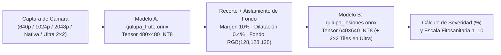

# Modelos de Visión Computacional — GulupaScan (`YOLO26n-seg` ONNX)

Esta carpeta documenta los modelos de segmentación de instancias integrados en **GulupaScan 0.3.0** para **Android** (`onnxruntime-android`) e **iOS** (`onnxruntime-objc`), diseñados para operar **100 % offline en campo**.

## Arquitectura en Cascada de 2 Etapas

## Resumen de Modelos y Métricas de Validación (vs. PyTorch)

| Etapa | Archivo en App (INT8) | Arquitectura | Tensor de Entrada | Salidas (`output0` / `output1`) | Peso FP32 | Peso INT8 | IoU Medio (FP32 / INT8) | Coincidencia Detección Principal | Ficha Técnica |
| :--- | :--- | :--- | :--- | :--- | :---: | :---: | :---: | :---: | :--- |
| **Etapa A (Localizador de Fruto)** | `gulupa_fruto.onnx` | `YOLO26n-seg` | `[1, 3, 480, 480]` | `[1, 300, 38]` / `[1, 32, 120, 120]` | 11.07 MB | **3.23 MB** | `0.9819` / **`0.9813`** | **100.0 %** | [`MODELO_A_FRUTO.md`](./MODELO_A_FRUTO.md) |
| **Etapa B (Segmentador de Lesiones)** | `gulupa_lesiones.onnx` | `YOLO26n-seg` | `[1, 3, 640, 640]` | `[1, 300, 38]` / `[1, 32, 160, 160]` | 11.14 MB | **3.30 MB** | `0.9029` / **`0.9022`** | **100.0 %** (INT8) | [`MODELO_B_LESIONES.md`](./MODELO_B_LESIONES.md) |

---

## ¿Por qué los tensores son `480×480` y `640×640` mientras la cámara permite elegir desde `640 px` hasta `Original` y `Ultra 2×2`?

1. **Resolución de Captura de Cámara (`Baja 640px`, `Media 1024px`, `Alta 2048px`, `Original del Sensor`, `Ultra 2×2`)**:
   - Define cuántos píxeles conserva la fotografía completa antes de recortar el fruto.
   - Si el fruto ocupa ~30 % del encuadre en una foto tomada a **2048 px** o **Resolución Original del sensor** (12 MP – 48 MP), el recorte del fruto conserva **≥ 640×640 píxeles reales** de corteza epidérmica antes de entrar al **Modelo B**, evitando interpolar hacia arriba.
2. **Ventana Interna de la Red Neuronal (`480×480` y `640×640`)**:
   - El **Modelo A (`480×480`)** solo necesita ubicar el contorno esférico global de la gulupa en la foto completa; `480×480` logra un **IoU de 98.13 %** en menos de 45 ms.
   - El **Modelo B (`640×640`)** recibe **únicamente el fruto ya recortado y con fondo gris neutro**, dedicando el 100 % de los `640×640` píxeles del tensor exclusivamente a la epidermis del fruto.
   - En modo **Ultra `2×2`**, el **Modelo B (`640×640`)** se ejecuta **5 veces** (1 vista global + 4 cuadrantes superpuestos al 60 % del fruto), alcanzando una resolución neuronal efectiva de **`1280×1280` píxeles** sobre la epidermis sin necesidad de reentrenar los pesos ONNX.

---

## Ubicación de los Pesos Binarios en el Repositorio

- **Android (Principal)**: `app/src/main/assets/gulupa_fruto.onnx` y `app/src/main/assets/gulupa_lesiones.onnx`
- **Android (CI/CD GitHub Actions)**: `app/android/app/src/main/assets/gulupa_fruto.onnx` y `app/android/app/src/main/assets/gulupa_lesiones.onnx`
- **iOS (Bundle Nativo)**: `iosApp/GulupaScan/Resources/gulupa_fruto.onnx` y `iosApp/GulupaScan/Resources/gulupa_lesiones.onnx`
- **Script de Verificación Cruzada**: [`scripts/referencia_onnx.py`](../scripts/referencia_onnx.py)
